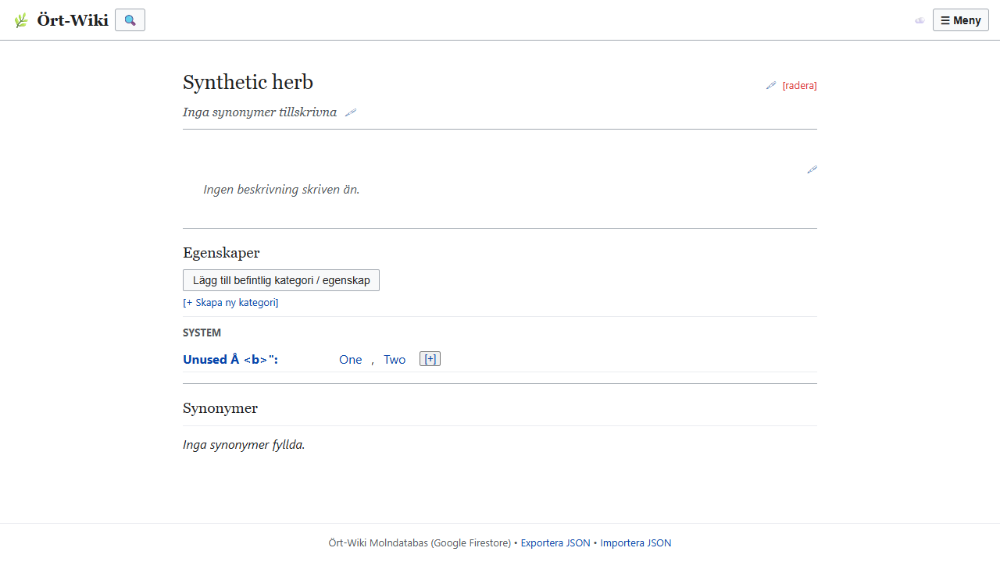

# Herb assignment — Task 012

READY FOR INDEPENDENT QA — NOT MERGED.

Baseline: `8912a461746d68dbe1bd0a438e4e84cdbc8270d4`, verified equal to origin/main at checkout.
Resulting implementation HEAD: `1349a0f94a3b598fb4df32e2066db337a97536bb`.
The subsequent report-only commit records this implementation; the PR head identifies the final delivery commit.

The herb renderer skipped categories without assigned properties, hiding their [+] editor. A persistent profile button now opens a searchable chooser over existing category keys, including unused and empty categories, with their system names. It opens the existing property checklist. Names are text nodes or encoded text; no definitions or identities are copied. The existing [+] is now a keyboard-operable button.

Saving compares initial and pending selections. Unchanged values (including zero, strings, arrays and objects) survive exactly; unchecked false values remain untouched. New assignments use true; explicit removals delete only that key. No-op and cancel do not persist. A changed draft persists once. Library, herb, category and changed property identities are checked before mutation; replaced libraries and removed/moved properties invalidate the draft. Renaming the same herb preserves its identity.

Changed files:

- `index.html`: chooser and differential assignment lifecycle.
- `tests/herb-assignment.test.cjs`: five Node regression cases against the real save function.
- `tests/browser-herb-assignment.cjs`: dedicated isolated browser suite.
- `tests/herb-assignment.png`: synthetic result evidence.
- `tests/HERB-ASSIGNMENT.md`: this report.

Validation:

- `node --test tests/*.test.cjs`: 120 passed, zero failures/skips (115 inherited assertions/tests preserved, five added).
- Chromium 155.0.8059.84: all nine suites PASS: core-rendering, filter-search, formula-rendering, glossary-rendering, import-smoke, property-rendering, study-routing, system-rendering, herb-assignment.
- `git diff --check`: PASS after preserving the original file line endings. An initial line-ending conversion caused whitespace failures and was corrected.
- New browser suite: zero uncaught errors and zero external requests. Firebase SDK/config/initialization removed before startup; external traffic blocked, disposable context and synthetic library only. Existing suites use their established isolation harnesses.

The new suite starts with zero assigned properties, searches/selects an unused category, checks two properties, and compares the entire resulting library to an independently modified expected snapshot. It independently counts persist calls and Storage.setItem writes: exactly one each. Cancel, reopen and unchanged save produce zero each. Existing non-Boolean values and false entries survive assignment of another property. Explicit unchecking removes only the intended key. Definitions, system records and unrelated metadata retain exact equality. Reload reads the saved assignments and the existing [+] reopens checked selections. Empty category discovery/save, renamed herb, deleted herb/category/property, moved property and replaced library are exercised. Unicode and markup-like category names render literally. Existing eight suites retain coverage for language/view choices, search, canonical routing, imports and backups.

For Frank: selecting an empty category does not establish a persistent herb/category relationship. The schema derives membership from properties. Empty membership would require a separate product decision; no membership field or artificial property was added.

Inherited limitations: existing modal cancellation/overlay behavior and cloud persistence implementation remain in place. Browser QA validates local persistence only, with no production records or services. This is not a manual mobile/accessibility audit. Property names and category names remain the existing identities; this does not migrate the schema or redesign synchronization. Invalidated drafts close without writing; users reopen to work with current data.
